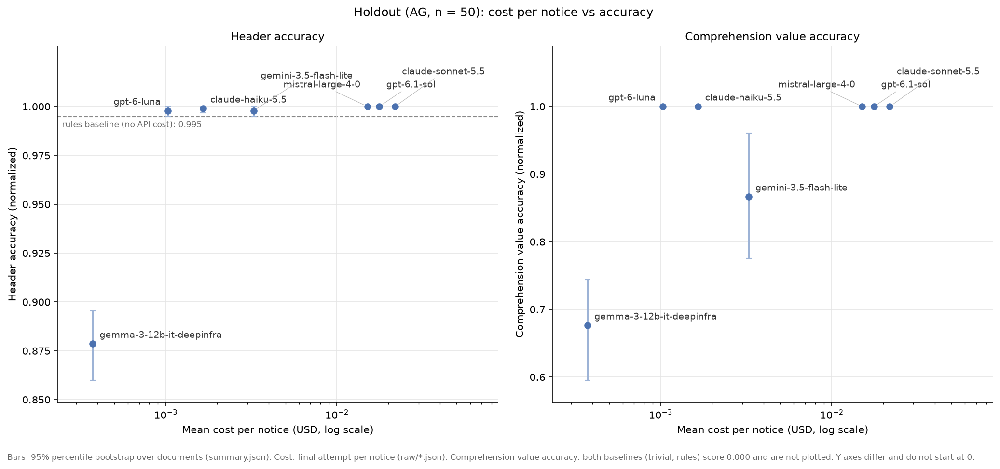

# shab-extraction-bench

**How reliably do LLMs extract structured JSON from Swiss commercial-register notices?**

Seven models and two baselines, scored field by field against 170 hand-annotated
German notices from the Swiss Official Gazette of Commerce (SHAB). The primary
result is a 50-notice holdout from a canton not sampled for development, drawn
and annotated after the prompt was frozen. Headline scores carry 95% bootstrap
intervals, and the gold labels were audited too.

## Key results

Holdout (canton AG, n = 50) unless marked dev. Details: [analysis notebook](notebooks/analysis.ipynb), section 10.

- **Header fields do not need an LLM.** A regex baseline reaches 0.995 header accuracy (trivial baseline: 0.227).
- **The top is saturated.** Five of seven models reach 1.000 comprehension value accuracy (105/105 values). Zero errors is not proof of perfection: the exact interval is [0.965, 1.000].
- **Cheap models come close.** claude-haiku-5.5 ($0.00166 per notice) and gpt-6-luna ($0.00103) reach that 1.000 at 9 to 21 times lower cost than gpt-6.1-sol, claude-sonnet-5.5 and mistral-large-4-0.
- **gemini-3.5-flash-lite is measurably weaker on comprehension:** 0.867 against 1.000 for haiku, paired-bootstrap difference +0.1333 [0.0400, 0.2250]; dev +0.0588 [0.0155, 0.1073].
- **The serving provider matters.** The same open-weight model, gemma-3-12b-it, scored 0.442 global accuracy on dev through one provider (empty completions on 62 of 120 notices) and 0.905 through another.
- **The labels were audited too.** 19 dev values in 15 notices and 3 holdout values were corrected; a random sample of 100 cells where all audit models agree with the gold found 0 errors (one-sided 95% upper bound 0.030).



*Holdout, mean cost per notice (log scale) against header accuracy (left) and comprehension value accuracy (right). Bars are 95% bootstrap intervals over notices; a point without a bar has zero errors (exact Clopper–Pearson intervals in notebook section 3).*

## Results (holdout, primary)

| Competitor | Comprehension value acc. [95% CI] | Header acc. | Notices fully correct | Cost / notice (USD) | Median latency (s) |
|---|---|---|---|---|---|
| baseline-trivial | 0.000 [0.000, 0.000] | 0.227 | 0/50 | – | – |
| baseline-rules | 0.000 [0.000, 0.000] | 0.995 | 1/50 | – | – |
| gpt-6-luna | 1.000 [1.000, 1.000] | 0.998 | 46/50 | 0.00103 | 7.3 |
| gpt-6.1-sol | 1.000 [1.000, 1.000] | 1.000 | 50/50 | 0.01767 | 9.7 |
| claude-haiku-5.5 | 1.000 [1.000, 1.000] | 0.999 | 47/50 | 0.00166 | 6.2 |
| claude-sonnet-5.5 | 1.000 [1.000, 1.000] | 1.000 | 50/50 | 0.02182 | 3.6 |
| gemini-3.5-flash-lite | 0.867 [0.776, 0.961] | 0.998 | 37/50 | 0.00326 | 2.1 |
| mistral-large-4-0 | 1.000 [1.000, 1.000] | 1.000 | 50/50 | 0.01508 | 83.9 |
| gemma-3-12b-it (DeepInfra) | 0.676 [0.595, 0.744] | 0.879 | 0/50 | 0.00037 | 13.4 |

"Fully correct": no error in any field or person list (post-hoc, notebook
section 5). [1.000, 1.000] means zero errors, not certainty. Baselines make no
API calls.

The dev table (BE/LU/ZH, n = 120) is in notebook section 2. Dev spreads the top
five a little more, from 0.975 (luna) to 0.995 (sol) in comprehension value
accuracy, but the pair tested, sol − luna, gives +0.0196 [−0.0053, 0.0538]: no
difference was detected.

## The task

SHAB notices publish changes in the Swiss commercial register: new companies,
changes (seat, name, capital, officers) and deletions. For each German-language
notice, a model returns one JSON object defined in [SCHEMA.md](SCHEMA.md):

- **Header fields (19):** act type, company names, UID, legal form, seat, address, register and prior-publication references, authority.
- **Comprehension fields (10):** act subtypes, new/previous name, act date, previous/new canton, new/previous capital, new/previous domicile.
- **Persons:** three lists (added, removed, changed) with attributes such as role, signature and nationality.
- **`extras`:** optional keys from a fixed registry (e.g. purpose, nominal value, audit opt-out), scored separately.

Header fields are those the regex baseline fills in at least one dev notice;
comprehension fields are those it never fills.

Why it is hard: legal German states before/after values implicitly, in
`[bisher: …]` brackets and "Bisher" (previous) blocks. Most fields are empty:
on the holdout, 386 of the 491 scored comprehension cells are empty in the
gold. And similar information lands in different fields. Below, the header
repeats an unchanged address under "Bisher"; the address that changed is a
secondary one and belongs in `extras`:

```
Mutation Ergotherapie NeuTakt GmbH, Belp
Ergotherapie NeuTakt GmbH
Rubigenstrasse 66
3123 Belp
Bisher
Rubigenstrasse 66
3123 Belp

Ergotherapie NeuTakt GmbH, in Belp, CHE-277.991.356, Gesellschaft mit beschränkter Haftung
(SHAB Nr. 28 vom 11.02.2026, Publ. 1006566216). Weitere Adressen: Oberdorfstrasse 35,
3612 Steffisburg [bisher: Waisenhausstrasse 8, 3600 Thun].
```

## Data

- **Dev, 120 notices:** 117 drawn at random (seed 42) from daily listings of Bern (42), Lucerne (23) and Zurich (52), plus 3 hand-picked warm-up notices. Used to develop the schema and prompt.
- **Holdout, 50 notices:** a simple random sample of the 59 German notices in one Aargau listing, drawn in two batches (seeds 42 and 43) after the prompt freeze. All 50 were annotated and committed before any model ran on them.
- **Gold labels:** annotated by hand by the author ([SCHEMA.md](SCHEMA.md), [ANNOTATION_GUIDE.md](ANNOTATION_GUIDE.md)); ambiguous cases are in [annotation_log.md](annotation_log.md).
- **Exclusions:** one French notice, dropped before sampling ([data/excluded/](data/excluded/)). No sampled notice was excluded.

The notices are public SHAB publications captured from www.shab.ch. The repo
contains the notice texts, gold labels, sampling listings and manifests, every
raw model response (`runs/*/raw/`) and every score (`results/`). Not committed:
the API key (`.env`) and the parsed responses (`runs/*/parsed/`), which are
rebuilt from the raw ones.

## Method

- **One frozen prompt** for all models, [prompts/extraction_v1.md](prompts/extraction_v1.md), with schema, vocabulary and annotation rules. Called through OpenRouter at temperature 0, one pass per notice, free JSON (no structured-output mode).
- **Provider pinning.** Open-weight models are pinned with `allow_fallbacks=false`, so the score measures the model, not the server: gemma-3-12b-it → DeepInfra, mistral-large-4-0 → Mistral (holdout; the unpinned dev run was also served by Mistral throughout). Proprietary models use default routing; each raw response records its provider.
- **Provider defaults, reasoning included.** `max_tokens` is 32768, since smaller caps truncated reasoning models in pilots; gemma-3-12b-it uses 8192 because of its provider's context window. Reasoning tokens count in cost.
- **Retries.** Transient errors, empty completions and `finish_reason=error` are retried within the call. At most one resume pass per run; anything still failing is scored `no_output` (one dev notice of mistral-large-4-0).
- **Baselines.** *Trivial:* each field's most frequent dev gold value (null when no value repeats). *Rules:* deterministic regex extraction, no LLM ([src/prefill.py](src/prefill.py)).
- **Pipeline:** [run_eval](src/run_eval.py) collects raw responses → [parse_responses](src/parse_responses.py) repairs JSON shape only, logging every repair → [evaluate](src/evaluate.py) writes `summary.json` and a per-cell failure listing, `fields.csv`.
- **Scoring.** Each cell is `correct`, `correct_null`, `omission`, `wrong`, `hallucination` or `no_output`, after Unicode, whitespace and case normalisation. Accuracy is split into *value accuracy* (gold has a value) and *null accuracy* (gold is empty), because all-null answers look accurate: the trivial baseline has 1.000 comprehension null accuracy and 0.000 value accuracy. Person lists, act subtypes and `extras` keys get F1. Metrics are micro-averages (sums over notices, one ratio). Fields marked uncertain by the annotator are not scored.
- **Uncertainty.** 95% percentile bootstrap over notices (10,000 resamples); a paired bootstrap on the same notices for model differences; exact Clopper–Pearson intervals where a model makes zero errors.

## Findings

Short versions of notebook section 10, where each claim points to its table.

1. **Header fields do not need an LLM.** The rules baseline (0.995 holdout header accuracy) scores 0.000 on comprehension, persons and `extras`, where the models add value.
2. **The holdout is saturated.** Sol, sonnet and mistral are fully correct on 50/50 notices, haiku 47/50, luna 46/50; the holdout cannot rank these five.
3. **Cheap models come close.** Per holdout notice, sol costs about 11 times as much as haiku and 17 times as much as luna. On dev, sol − luna differs by only +0.0023 [0.0003, 0.0049] in global accuracy. Caveat: luna's holdout `extras` key F1 is 0.901 [0.769, 0.968] against 1.000 for sol, a pair that was not tested.
4. **gemini-3.5-flash-lite is weaker on comprehension.** It has the lowest median latency (2.1 s against 6.2 s for haiku), but haiku is cheaper ($0.00166 against $0.00326) and higher on comprehension value accuracy.
5. **The small open-weight model is not usable here.** gemma-3-12b-it on DeepInfra is the cheapest ($0.00037) but scores 0.879 holdout header accuracy, below the rules baseline, and 0/50 notices fully correct. Via NextBit, OpenRouter's default route, it returned empty completions on 62 of 120 dev notices (global accuracy 0.442 against 0.905); on the 58 it answered, accuracy was similar (0.915 against 0.900; not a random subset).
6. **The labels had to be audited too.** See [Gold audit](#gold-audit).

**Recommendation.** On this evidence, claude-haiku-5.5 is the strongest choice
for its cost: 1.000 holdout comprehension value accuracy, 47/50 notices fully
correct, 0.990 on dev, at $0.00166 per notice. gpt-6-luna is the cheapest
strong option ($0.00103), but it has the lowest holdout `extras` key F1 of the
five strong models (0.901) and 46/50 fully correct notices. Rules can serve as
a cheap cross-check on the header fields an LLM returns, not as a replacement.
This rests on 50 holdout notices from one canton.

## Gold audit

A wrong label penalises the models that are right. Three methods selected
cells, and the author checked each against the notice
([results/gold_audit/](results/gold_audit/)):

- **Model consensus** ([src/audit_gold.py](src/audit_gold.py)): at least 3 of five models (gpt-6-luna, gpt-6.1-sol, claude-haiku-5.5, claude-sonnet-5.5, gemini-3.5-flash-lite) agree on a value that differs from the gold.
- **Rule sweep** ([src/gold_rule_sweep.py](src/gold_rule_sweep.py)): nine rules of the frozen prompt as literal checks on each gold record and its notice. No model output is used.
- **Random sample:** 100 cells where all five models agree with the gold; 0 errors (one-sided 95% upper bound 0.030).

**Result.** 19 dev values in 15 notices and 3 holdout values were corrected.
The rule sweep flagged 17 of the 19 dev corrections (15 together with model
consensus, 2 on its own); the other 2 came from consensus only.

**Traceability.** Each correction is listed with old value, new value and
reason in [corrections/gold_corrections_2026-10-14.json](corrections/gold_corrections_2026-10-14.json),
applied by [src/apply_gold_corrections.py](src/apply_gold_corrections.py)
(dry run by default; aborts the whole batch if a current value matches
neither the expected old value nor the new one). Pre-correction results are kept under the git tag
`pre-gold-correction`.

**Effect** on dev comprehension value accuracy: sol, haiku, sonnet and mistral
rose by +0.0152 to +0.0156; luna (−0.0044), gemini (−0.0234) and gemma
(−0.0100) fell. Eight dev corrections are domiciles: six "Bisher" values the
old gold left empty (notices 0063, 0072, 0119) and two wrong values in 0008;
luna had left them empty in two of these notices, gemini in all three. No
holdout key metric changed.

## Limitations

- 50 holdout notices from one canton (AG); the top of the ranking is saturated.
- Cost and latency count only the final attempt per notice: lower bounds.
- Clopper–Pearson intervals treat fields as independent, but fields within a notice are correlated, so they are too narrow; the bootstrap resamples whole notices.
- 12 paired comparisons, not corrected for multiple comparisons.
- Open-weight results depend on the serving provider.
- Proprietary models were not pinned to a provider and used OpenRouter's default routing; the serving provider is recorded in each raw response (e.g. the holdout gpt-6.1-sol run was served by Azure on 18 of 50 notices and by OpenAI on the rest).
- Cells where the audit models disagree without a 3-model consensus were audited only by the rule sweep.
- One annotator; inter-annotator agreement was not measured.
- One run per model and split; run-to-run variation was not measured.

## Future work

- A harder holdout v2 (more cantons, harder notices) to separate the top models.
- Structured output (JSON-schema mode) against free JSON, with the same prompt.
- A hybrid pipeline: rules as a cross-check on header fields, an LLM for comprehension, persons and `extras`.

## Reproduce

Python 3.11+. Every module runs as `python -m src.<module>` from the repo root.

```bash
git clone https://github.com/pabloskys-create/shab-extraction-bench
cd shab-extraction-bench
python -m venv .venv
source .venv/bin/activate        # Windows: .venv\Scripts\activate
pip install -r requirements.txt
python -m pytest
```

**1. Re-score the saved responses (no API calls, no cost).** Every metric and
every `fields.csv` match the committed `results/` exactly; `summary.json` differs
only in the evaluator commit hash it records:

```bash
python -m src.parse_responses --run-id holdout-claude-haiku-5.5
python -m src.evaluate --run-id holdout-claude-haiku-5.5

for run in runs/*/; do            # every run
  run=$(basename "$run")
  python -m src.parse_responses --run-id "$run" && python -m src.evaluate --run-id "$run"
done
```

The audit tools refuse to overwrite the committed CSVs (which hold the original
audit and its verdicts), so write elsewhere; on the corrected gold they return
fewer rows. The consensus audit needs the parsed dev runs from above.

```bash
python -m src.gold_rule_sweep --split dev --out-dir results/scratch/gold_audit
python -m src.audit_gold --split dev --out-dir results/scratch/gold_audit
python -m src.apply_gold_corrections --file corrections/gold_corrections_2026-10-14.json   # dry run, writes nothing
```

**2. Open the notebook.** It reads `results/`, `runs/*/raw/` and, for section 9,
the tag `pre-gold-correction`.

```bash
jupyter lab notebooks/analysis.ipynb
```

**3. Re-run a model (costs money).** Put `OPENROUTER_API_KEY=...` in a `.env`
file at the repo root (git-ignored). Run ids under `scratch/` stay out of git.
For scale, the dev run of claude-sonnet-5.5 cost $2.5387 (final attempts only,
notebook section 7).

```bash
python -m src.run_eval --split dev --backend openrouter \
  --model anthropic/claude-haiku-5.5 --run-id scratch/dev-claude-haiku-5.5
python -m src.parse_responses --run-id scratch/dev-claude-haiku-5.5
python -m src.evaluate --run-id scratch/dev-claude-haiku-5.5

# pinned open-weight model
python -m src.run_eval --split dev --backend openrouter --model google/gemma-3-12b-it \
  --openrouter-provider DeepInfra --max-tokens 8192 --run-id scratch/dev-gemma-3-12b-it
```

Holdout runs also need `--allow-holdout`. Model ids: `openai/gpt-6-luna`,
`openai/gpt-6.1-sol`, `anthropic/claude-haiku-5.5`, `anthropic/claude-sonnet-5.5`,
`google/gemini-3.5-flash-lite`, `mistralai/mistral-large-4-0`, `google/gemma-3-12b-it`.

## Repository layout

```
data/raw/             dev notice texts (immutable)
data/exploratory/     dev gold labels (120)
data/holdout/         holdout notices, gold labels and sampling manifests
data/sampling/        dev sampling listings and manifests
data/excluded/        excluded notice (reason in annotation_log.md)
prompts/              the frozen extraction prompt
src/                  run_eval, parse_responses, evaluate, baselines, audit tools
tests/                pytest suite
runs/<run>/raw/       every raw model response, with usage and cost
results/<run>/        summary.json (metrics, CIs) and fields.csv (per-cell outcomes)
results/gold_audit/   audit candidates, rule sweep, random sample, with verdicts
corrections/          reviewed gold corrections
notebooks/            analysis notebook and figures
```

## How this project was built

I designed the benchmark, annotated all gold labels by hand, ran the
experiments and made the methodological decisions. The code and the analysis
notebook were drafted with Claude Code (Anthropic) under my
direction. I reviewed and verified every result before publishing it.

## Author

Pablo — Data Science and Engineering student, Universidad de Murcia (Erasmus at THI Ingolstadt).
